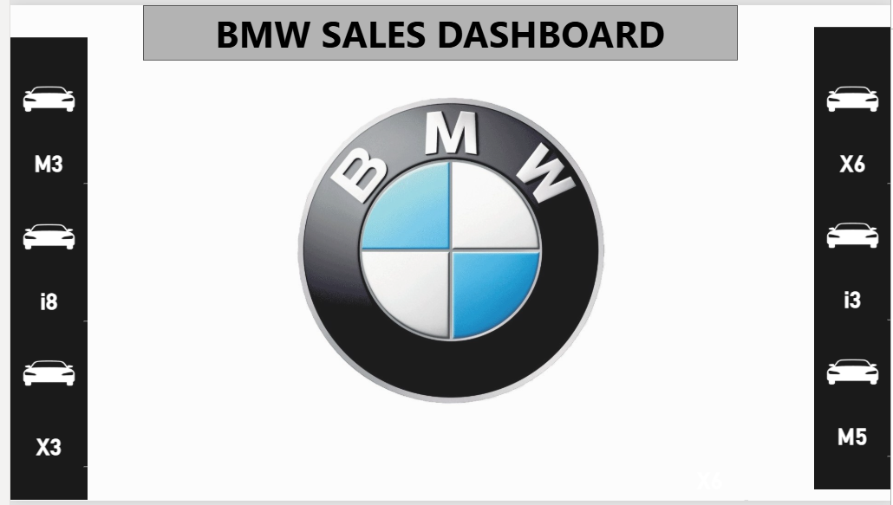
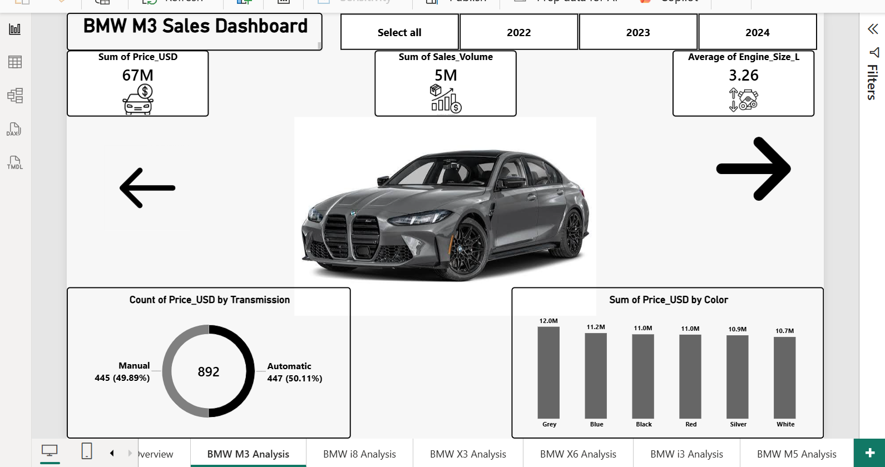
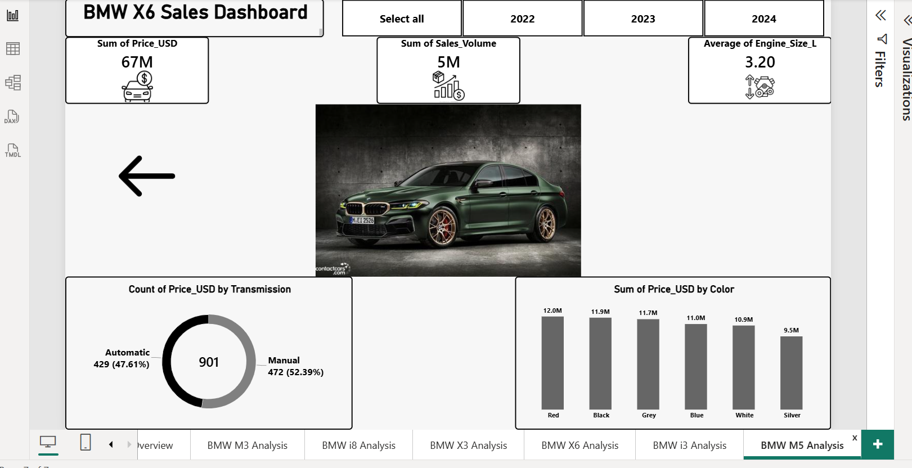
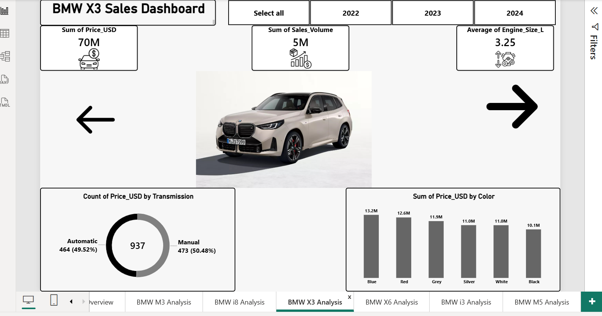
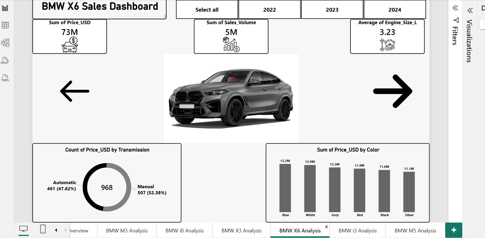
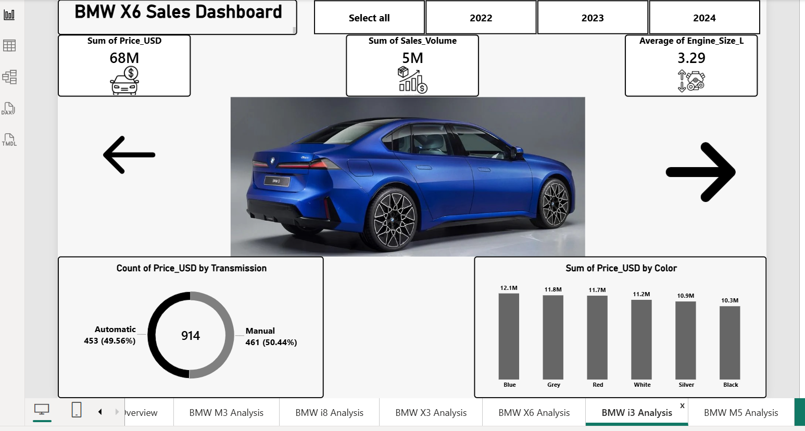
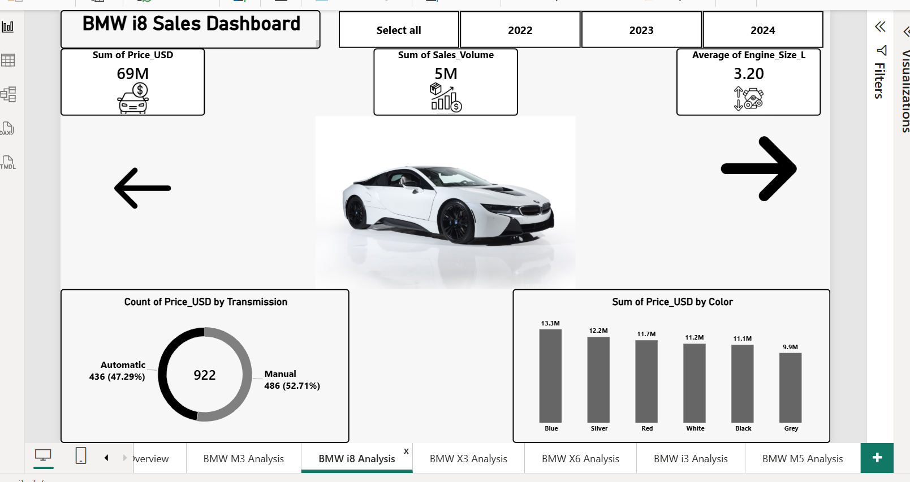

# BMW Sales Analysis Dashboard | Power BI

## 📌 Project Overview

The **BMW Sales Analysis Dashboard** is an interactive data visualization project developed using **Microsoft Power BI** to explore and analyze BMW sales data.

The project presents sales-related information through interactive dashboards dedicated to an overall sales overview and individual BMW models. It transforms data into visual reports that help users explore patterns, compare models, and understand sales performance more easily.

This project demonstrates practical skills in data analysis, dashboard development, data visualization, and business intelligence reporting.

## 🎯 Project Objectives

The main objectives of this project are to:

- Analyze BMW sales data through interactive visual reports.
- Provide an overall view of the available sales information.
- Explore sales data for different BMW models.
- Make it easier to compare model-level performance.
- Present data in a clear and organized visual format.
- Demonstrate the use of Power BI to build an analytical dashboard.

## 📊 Dashboard Pages

The project includes **seven dashboard views**, covering an overall sales overview and six individual BMW models.

| Dashboard Page | Description |
|---|---|
| BMW Sales Overview | Provides an overall view of the sales data and the main information presented in the report. |
| BMW M3 Analysis | Focuses on the available sales information for the BMW M3 model. |
| BMW M5 Analysis | Presents the sales data associated with the BMW M5 model. |
| BMW X3 Analysis | Explores the available sales information for the BMW X3 model. |
| BMW X6 Analysis | Presents the sales data associated with the BMW X6 model. |
| BMW i3 Analysis | Explores the available sales information for the BMW i3 model. |
| BMW i8 Analysis | Presents the sales data associated with the BMW i8 model. |

## 🖼️ Dashboard Preview

### 1. BMW Sales Overview

The overview page provides a general perspective on the BMW sales dataset and serves as the starting point for exploring the report.

### 2. BMW M3 Analysis

### 3. BMW M5 Analysis

### 4. BMW X3 Analysis

### 5. BMW X6 Analysis

### 6. BMW i3 Analysis

### 7. BMW i8 Analysis

## 🛠️ Tools & Technologies

- **Microsoft Power BI** — Developing interactive dashboards and visual reports.
- **Data Visualization** — Presenting sales-related information through visual elements.
- **Data Analysis** — Exploring the available dataset to understand sales information and compare BMW models.
- **Business Intelligence** — Organizing data into reports that support analysis and interpretation.

## 💡 Key Features

- A dedicated overview dashboard for BMW sales data.
- Individual dashboard pages for six BMW models.
- Organized visual reporting for easier data exploration.
- Model-level analysis to help compare the information available for different vehicles.
- A consolidated Power BI report for exploring the project in one place.

## 📈 Skills Demonstrated

Through this project, I demonstrate my ability to:

- Build interactive reports using Microsoft Power BI.
- Present data in a clear and structured way.
- Explore and analyze sales-related datasets.
- Organize dashboards around an overall view and individual categories.
- Communicate analytical information through data visualization.
- Develop business intelligence dashboards for portfolio presentation.

## 📁 Repository Contents

This repository contains the following project files:

- `BMW-Sales-Analysis.pbix` — The Power BI report file.
- `README.md` — Project documentation and dashboard previews.
- `dashboard-overview.png` — Screenshot of the overall sales dashboard.
- `dashboard-M3.png` — Screenshot of the BMW M3 dashboard.
- `dashboard-M5.png` — Screenshot of the BMW M5 dashboard.
- `dashboard-X3.png` — Screenshot of the BMW X3 dashboard.
- `dashboard-X6.png` — Screenshot of the BMW X6 dashboard.
- `dashboard-i3.png` — Screenshot of the BMW i3 dashboard.
- `dashboard-i8.png` — Screenshot of the BMW i8 dashboard.

## 🚀 How to View the Project

To explore the complete dashboard:

1. Open or download the `BMW-Sales-Analysis.pbix` file from this repository.
2. Open the file using **Microsoft Power BI Desktop**.
3. Explore the available dashboard pages.
4. Review the overall sales overview and the individual BMW model dashboards.

> **Note:** The Power BI report requires compatible software to open. Dashboard screenshots are available above for a quick preview.

## 🔍 Project Insights

The dashboard is designed to support the exploration of BMW sales data at both an overall and model-specific level. It provides a visual starting point for identifying patterns and comparing the information available across the selected BMW models.

Specific business findings should be based on the actual values and visuals displayed in the report.

## 👩‍💻 Author

**Donia Khaled**

Aspiring Data Analyst | Power BI | Data Visualization | Business Intelligence

Explore my work and projects on [LinkedIn](https://www.linkedin.com/in/donia-ahmed-34a2422b5).

---

⭐ If you find this project useful, feel free to explore the repository and review the dashboard screenshots.

**Thank you for visiting my project!**
